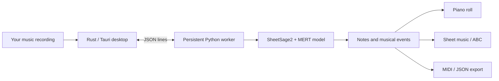

# SheetSage Studio

A local desktop workspace for turning music recordings into melody, chords, a piano roll, and sheet music with [SheetSage2](https://huggingface.co/m-a-p/SheetSage2).



Local inference • Model stays warm between jobs • No npm/frontend build • No cloud inference service

## Set up on macOS

Verified on Apple Silicon macOS with CPU/FP32 inference. Other platforms are not validated.

| Need | Purpose |
| --- | --- |
| Git + Python 3.10 or newer | Clone and run the setup helper |
| [uv](https://docs.astral.sh/uv/getting-started/installation/) | Install an isolated Python 3.11 model environment |
| Stable [Rust](https://www.rust-lang.org/tools/install) + Xcode Command Line Tools | Build the native app |
| 8 GiB free for model setup + about 2 GiB for a Rust build | Weights, dependencies, and build headroom |
| 16 GiB RAM recommended | Planning guidance, not a measured minimum |

Check the native toolchain; install Xcode Command Line Tools if missing:

```sh
xcode-select -p
# If missing: xcode-select --install
rustc --version
cargo --version
uv --version
```

Clone, install the pinned download tool, and prepare the model:

```sh
git clone https://github.com/quangng2000/sheetsage-studio.git
cd sheetsage-studio
uv tool install huggingface-hub==1.27.0
uv tool update-shell
# Open a new terminal if hf is not yet on PATH, then return to this folder.
hf version
python3 run.py check
python3 run.py setup
python3 run.py download-sample
```

Setup downloads approximately 2.76 GB of model weights plus dependencies. Weights, upstream model code, and demo audio are downloaded separately, not shipped in this repository. The model repositories were public and ungated when tested; no Hugging Face token was needed.

## Run

```sh
cargo run --manifest-path desktop/Cargo.toml --locked
```

In the app: **Explore the demo → Transcribe → Piano roll / Sheet music / Events → export MIDI, ABC, or JSON.** Or choose your own music recording. “Warm model” loads the model before your first job.

Build a local `.app` instead:

```sh
sh desktop/build-app.sh
open "desktop/dist/SheetSage Studio.app"
```

The app uses this checkout's `runtime/` directory. Keep the checkout in place: the `.app` does **not** bundle Python or model weights. If the checkout is moved after building, rebuild or launch the executable with `SHEETSAGE_LAB_ROOT` pointing to the checkout; see the [runbook](docs/AGENT_RUNBOOK.md#moving-a-checkout-or-using-an-external-drive).

### CLI only

```sh
python3 run.py transcribe samples/demo.mp3 --max-seconds 20
# Or: python3 run.py transcribe /absolute/path/to/music.wav --max-seconds 60
```

```text
runtime/outputs/<recording>-<timestamp>/
├── result.json         # Summary and diagnostics
├── events.json         # Musical events
├── playback.json       # Piano-roll note tracks
├── score.abc           # Notation, when generated
└── transcription.mid   # MIDI, when generated
```

## What to expect

| Capability | Status |
| --- | --- |
| Native desktop, audio playback, piano roll, notation, history, exports | Implemented |
| CPU/FP32 | Verified locally on M4 Max |
| Offline inference after setup | Implemented; no model download during desktop inference |
| Live microphone / streaming transcription | Not implemented; transcription is a batch job |
| Apple MPS | Experimental CLI option only; unvalidated |
| Windows / Linux desktop | Unvalidated |

One local 20-second demo transcription took about **24 seconds after model loading**, with the warm worker using about **4 GiB RAM**. This is a smoke-test observation, not a benchmark or a minimum-memory guarantee. The official encoder pads its input window to **300 seconds**, including shorter excerpts. Encoding has no intermediate progress callbacks; cancellation waits for the next callback. Transcription quality and notation completeness vary with the recording.

## For developers and other agents

- [AGENTS.md](AGENTS.md): repository rules and quick verification commands.
- [Detailed runbook](docs/AGENT_RUNBOOK.md): clean-machine setup, pinned model downloads, worker protocol, validation, and troubleshooting.
- [sources.json](sources.json): model and sample provenance.

Copy this instruction to another coding agent:

> Clone https://github.com/quangng2000/sheetsage-studio.git. Read AGENTS.md and docs/AGENT_RUNBOOK.md. Check prerequisites and disk space, download the pinned models with run.py setup, fetch the demo with run.py download-sample, run the CPU smoke test and unit tests, then launch the native desktop app. Do not upload recordings or delete other model caches. Report what actually passed and any unsupported platform assumptions.

## Credits and usage terms

Original application code is [Apache-2.0 licensed](LICENSE). See [NOTICE](NOTICE) and [third-party notices](THIRD_PARTY_NOTICES.md) for attribution and separate terms.

This is an independent local UI, not the official SheetSage2 project. Research/model credit belongs to [SheetSage2](https://arxiv.org/abs/2610.05336), [its authors and model repository](https://huggingface.co/m-a-p/SheetSage2), and [MERT-v2-FullSong](https://huggingface.co/m-a-p/MERT-v2-FullSong). Sheet-music rendering uses [abcjs](https://github.com/paulrosen/abcjs), with its MIT license preserved in `desktop/ui/assets/LICENSE.abcjs`.

**The MERT base weights are licensed CC BY-NC 4.0.** The desktop application's license does not override model, upstream-code, dependency, or audio terms. Review the downloaded `LICENSE` / `THIRD_PARTY_NOTICES.md` files and model cards before use, especially commercial use. Only transcribe audio you are entitled to use.
