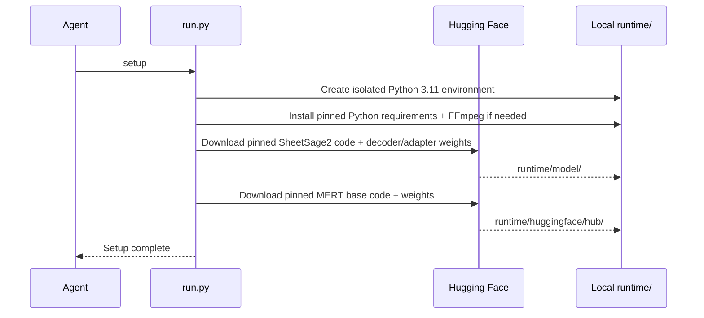

# Reproduce SheetSage Studio

This runbook is for a person or coding agent starting from a clean clone. The validated path is **Apple Silicon macOS → CPU/FP32 → local model → native Tauri app**. No cloud account, inference API key, npm package installation, or hosted server is required.

## 1. Inspect before installing

```sh
git clone https://github.com/quangng2000/sheetsage-studio.git
cd sheetsage-studio
git status --short
python3 --version
xcode-select -p
rustc --version
cargo --version
uv --version
```

Read `AGENTS.md`, `run.py`, `requirements-model.txt`, and `sources.json`. Model inference uses `trust_remote_code=True` with the downloaded, pinned upstream model implementation: this runs Python code from those snapshots. The revision pins are a reproducibility boundary, not a guarantee that external code is safe. Review changes before upgrading them.

If tools are missing:

- Install [Xcode Command Line Tools](https://developer.apple.com/xcode/resources/) with `xcode-select --install` and complete the system dialog.
- Install current stable [Rust via rustup](https://www.rust-lang.org/tools/install), then reopen the terminal so Cargo is on PATH.
- Install [uv](https://docs.astral.sh/uv/getting-started/installation/) using its documented installer or your existing package manager.
- Use Python 3.10 or newer for the setup helper. Setup itself provisions Python 3.11 for model execution.

Do not overwrite existing system tools or switch the user's global Python environment to satisfy this project.

## 2. Install the download tool and check resources

```sh
uv tool install huggingface-hub==1.27.0
uv tool update-shell
```

Open a new terminal if needed, return to the clone, then run:

```sh
hf version
python3 run.py check
```

Resource planning:

| Resource | Budget / observation |
| --- | --- |
| Model checkpoint bytes | 2,758,551,412 total, approximately 2.76 GB |
| Fresh Python/model setup | At least 8 GiB free, including packages and temporary files |
| Native Rust build | Allow about 2 GiB additional headroom; toolchain installation may need more |
| RAM | 16 GiB recommended for planning, not a validated minimum |
| Observed warm model worker | About 4 GiB RSS on an M4 Max; runtime peaks can be higher |

`check` is read-only. A fresh runtime with insufficient space is a setup blocker; do not delete unrelated data. An already-prepared runtime does not need a second 8 GiB download budget merely to run inference. Every transcription still needs output space.

## 3. Download the pinned runtime

```sh
python3 run.py setup
python3 run.py download-sample
python3 run.py check
```

`setup` performs these local actions:



| Component | Repository | Exact revision |
| --- | --- | --- |
| Transcriber / decoder / adapter | `m-a-p/SheetSage2` | `b83c3d79a6d98bcffaf8f9ed112c90aa887887bc` |
| Parent music encoder | `m-a-p/MERT-v2-FullSong` | `d8ba1c745e733b3908ce6ad16ebeb17ac7600a42` |

The parent revision comes from the pinned SheetSage2 configuration. Download both: the smaller SheetSage2 checkpoint is not standalone. Do not download arbitrary “latest” MERT weights or change config hashes to bypass a mismatch.

Expected layout after setup:

```text
runtime/
├── .venv/bin/python
├── .venv/bin/ffmpeg              # Local fallback if no suitable executable was found
├── model/
│   ├── config.json
│   ├── infer.py
│   ├── modeling_sheetsage2.py
│   └── model.safetensors
└── huggingface/hub/
    └── models--m-a-p--MERT-v2-FullSong/
        └── snapshots/<pinned-revision>/
            ├── config.json
            └── model.safetensors
samples/
└── demo.mp3
```

The public model downloads did not require login when tested. If access requirements change, let the user authenticate through `hf auth login`; never ask them to paste a token into chat or commit credentials. The isolated model environment and the `hf` tool intentionally have separate dependency environments.

The sample command fetches the official project demo and verifies its recorded SHA-256. A changed or failed checksum is a reason to inspect the source, not remove verification. The audio is not included in Git. You can skip it and supply a recording you are entitled to use.

## 4. Run a real model smoke test

```sh
python3 run.py transcribe samples/demo.mp3 --max-seconds 20
```

The command prints an output directory under `runtime/outputs/`. Inspect that exact directory rather than an old successful run:

| Artifact | What to inspect |
| --- | --- |
| `result.json` | Duration, summary, warnings, notation diagnostics; valid JSON and no error result |
| `events.json` | Nonempty musical events for a normal demo run; finite timestamps |
| `playback.json` | Note tracks used by the piano roll |
| `transcription.mid` | MIDI export, if generated; recognizable as a MIDI file |
| `score.abc` | ABC notation, if generated |
| `score.browser.abc` | Optional browser-compatible notation used in preference to `score.abc` |

One local 20-second demo produced 87 musical events and completed in about 24 seconds after model loading on an M4 Max. Do not use that number as an assertion for every platform or model run. Validate structure and diagnostics rather than inventing musical accuracy from a successful exit code. ABC generation can be incomplete even when event transcription succeeds.

The encoder pads to a 300-second window even for `--max-seconds 20`. A short excerpt does not imply a proportionally short encoding step. Setup and first loading take longer than a warm job. This is batch transcription, not live microphone streaming.

## 5. Run and inspect the native app

```sh
cargo run --manifest-path desktop/Cargo.toml --locked
```

Manual smoke test:

1. Click **Explore the demo**, or **Choose audio** and select a recording.
2. Keep **First 20 seconds** selected for an initial test.
3. Optionally click **Warm model**; wait for the ready state.
4. Click **Transcribe**. The window should remain responsive while Python executes the model.
5. Inspect **Piano roll**, **Sheet music**, and **Events**. Play and seek the original audio.
6. Export **MIDI**, **ABC**, and the event **JSON** to user-selected destinations.
7. Run another job: the worker should retain the model instead of loading it again.
8. Inspect history, including reopening a successful run after restarting the app.
9. If testing cancellation, expect a delay during encoding. Cancelled partial outputs must not appear as completed history entries.

Imported recordings are copied into `runtime/uploads/`. Transcriptions remain in `runtime/outputs/`. Nothing in this pipeline uploads recordings to a cloud inference service.

Create a local app bundle:

```sh
sh desktop/build-app.sh
open "desktop/dist/SheetSage Studio.app"
```

The script builds with Cargo's development profile and ad-hoc signs the local bundle. This is not a notarized, self-contained distribution or an installer. Retain the source checkout, its Python environment, and its model runtime.

## 6. Verify code without downloading a model

```sh
python3 -m unittest discover -s tests -v
python3 -m unittest discover -s desktop -p 'test_*.py' -v
cargo test --manifest-path desktop/Cargo.toml --locked
node --check desktop/ui/app.js
```

The worker tests exercise parsing, lifecycle, cancellation, errors, serialized exports, and the stdout protocol with a fake model. They do not establish transcription quality or GPU correctness. Rust tests cover the catalog, path containment, completed-run handling, and request lifecycle helpers. The optional Node command only checks JavaScript syntax; Node is not needed to run the app.

## 7. Worker protocol for integration

The desktop launches one persistent process:

```sh
runtime/.venv/bin/python -u desktop/worker.py --lab-root "$PWD"
```

Send one JSON object per stdin line, retaining the process between jobs:

```json
{"id":"warm-1","command":"load"}
{"id":"run-1","command":"transcribe","audio_path":"/absolute/path/to/music.mp3","audio_name":"music.mp3","max_seconds":20}
{"id":"cancel-1","command":"cancel"}
{"id":"close-1","command":"shutdown"}
```

These are separate example requests, **not** a batch to paste simultaneously. Wait for the warm/load request to reach `ready` before submitting a transcription; only one model operation can be active. A `shutdown` request terminates the process after any active operation reaches a cancellation point. EOF also closes the worker.

Stdout contains JSON events only: `connected`, `status`, `progress`, `result`, `error`, and `cancelled`. Diagnostics and model-library output go to stderr. Match response IDs to requests. Stages are genuine model callbacks, not a percentage completion estimate. A `result` event carries a JSON-compatible summary, ABC source, playback tracks, events, and paths to the local artifacts.

The worker validates file existence and excerpt durations in `(0, 300]`. The Rust app additionally restricts audio to the checkout's `samples/` or imported `runtime/uploads/` paths. Do not weaken those path restrictions when adding UI features. A desktop job's `ui.json` file is published atomically only after successful result validation; `.desktop-job.json` alone is not success.

## Moving a checkout or using an external drive

The easiest desktop setup is to clone the **whole project** onto a drive with sufficient room, then run setup and build there. The desktop always looks for `runtime/` inside its selected project root.

If a previously built checkout is moved, either rebuild there or launch its binary with the root explicitly selected:

```sh
SHEETSAGE_LAB_ROOT="/absolute/path/to/sheetsage-studio" \
  "/absolute/path/to/sheetsage-studio/desktop/dist/SheetSage Studio.app/Contents/MacOS/sheetsage-studio"
```

The variable identifies the **checkout**, not the model directory. It does not make the app bundle self-contained.

For **CLI-only** work, model storage may be separate:

```sh
python3 run.py --storage /Volumes/External/SheetSage2 check
python3 run.py --storage /Volumes/External/SheetSage2 setup
python3 run.py --storage /Volumes/External/SheetSage2 transcribe samples/demo.mp3 --max-seconds 20
```

This does not redirect the desktop's runtime. Do not promise external CLI storage works in the GUI without implementing and testing that configuration.

## Troubleshooting and reporting

| Symptom | Safe next check |
| --- | --- |
| `uv` / `hf` / Cargo not found | Inspect PATH and installation; reopen the terminal after tool installation |
| Setup reports insufficient disk | Report free/required space; use an external drive or ask the user what may be removed |
| Weights missing or parent snapshot not found | Rerun setup with the same storage path and pinned revisions; do not modify hashes |
| Sample is missing | Run `python3 run.py download-sample` or choose your own recording |
| Sample checksum mismatch | Inspect upstream changes and the manifest; do not disable verification |
| App says Python/model missing | Check that setup ran in this checkout's default `runtime/`, not CLI-only external storage |
| Long encoding step / delayed cancel | Expected between encoder callbacks; inspect stderr and process health before treating it as a hang |
| ABC/score missing | Inspect model notation diagnostics; events or MIDI may still exist |
| MPS fails | Return to CPU/FP32; MPS is experimental and not the desktop path |
| App moved to another computer | Clone, set up, and build on the destination; the bundle contains neither Python nor weights |

When handing off, include the OS/architecture, project commit, pinned model revisions, commands run, actual exit statuses, and the exact generated run directory. Distinguish unit tests, real CPU inference, native UI inspection, and untested capabilities. Do not include tokens, private recordings, machine-specific user paths, or outputs in public commits.

## Sources and terms

- [SheetSage2 paper](https://arxiv.org/abs/2610.05336)
- [Official SheetSage2 model](https://huggingface.co/m-a-p/SheetSage2)
- [MERT-v2-FullSong base model](https://huggingface.co/m-a-p/MERT-v2-FullSong)
- [abcjs renderer](https://github.com/paulrosen/abcjs) — preserved MIT notice at `desktop/ui/assets/LICENSE.abcjs`

The MERT base weights carry CC BY-NC 4.0 terms. Upstream model/code, dependencies, and audio retain their own applicable terms; this application's license does not replace them. Review the downloaded model notices before use or redistribution. This repository deliberately excludes model weights, downloaded upstream code, and demo audio.
