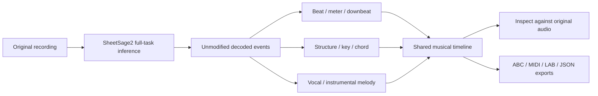

# Musical analysis: predictions, timeline, and exports

SheetSage Studio presents the released SheetSage2 model's supported musical tasks in one synchronized workspace. This is **inference with a pretrained model**, not a reproduction of the paper's data generation, training, evaluations, or ablations.



## What each view means

| Information | Model output / export | Interpretation |
| --- | --- | --- |
| Beat positions | Rhythm events; `beat.lab` | Decoded beat timestamps and positions within the meter |
| Downbeats | Beat position 1; `downbeat.lab` | Predicted beginnings of bars, not fixed-duration audio slices |
| Meter | `values.rhythm.meter`; beat rows | Time signatures may change during the analyzed excerpt |
| Tempo | Derived from timed beat spacing | An estimate in **quarter notes per minute**, not a separate model tempo prediction |
| Song structure | `structure.lab` / `values.structure` | Predicted interval labels such as intro, verse, or chorus |
| Key | `key.lab` / `values.key` | Predicted tonal intervals; a recording can contain key changes |
| Chords | `chord.lab` / `values.chord` | Full-chord task; LAB spelling is corrected using the predicted key by upstream export code |
| Vocal melody | `melody_vocal.lab` / melody track 0 | Note onsets, offsets, and MIDI pitches classified as vocal melody |
| Instrumental melody | `melody_instrumental.lab` / melody track 1 | Melody notes classified as instrumental, **not** all instrument stems |
| Score | `score.abc`, when available | Notation derived from the predictions; may contain documented notation-only adjustments |
| Playback / MIDI | `playback.json`, `transcription.mid`, part MIDIs | Synthesizable notes, including upstream chord voicings; not separated audio |
| Diagnostics | `result.json` | Export/notation warnings and settings, **not** an accuracy or confidence score |

The full-task prompt set remains upstream's default: `timestamp`, `downbeat_meter`, `structure`, `key`, `chord_full`, and `melody_full`. Alternative task names in the model schema are selectable formulations of chord/melody tasks, not additional instrument stems. The app does not need to rerun a separate model for each lane.

## Read the tempo correctly

In `beat.lab`, each row is:

```text
time_seconds    beat_position_1_based    meter_numerator    meter_denominator
1.19            1                        4                  4
1.53            2                        4                  4
```

The upstream format uses **denominator beats**. For adjacent beats in an unchanged meter:

```text
quarter-note BPM = 60 / seconds_between_beats × 4 / meter_denominator
```

Examples: consecutive 4/4 beats spaced 0.5 seconds imply 120 quarter-note BPM; consecutive 6/8 eighth-note beats spaced 0.25 seconds also imply 120 quarter-note BPM. Dotted-quarter pulse in 6/8 is a different display convention; do not silently label it as quarter-note BPM.

Only use valid, increasing beat times with a consistent meter and known beat progression. Missing beats, sparse events, meter boundaries, or inconsistent predictions can make an interval unsuitable. Do not fill gaps with invented model events or show a confident number when evidence is insufficient. Raw rhythm uses `eighth_position`, which is not always the same index as the displayed denominator beat.

## Inspect an analysis

1. Import a recording and choose the excerpt length, then transcribe.
2. Compare predicted sections, key, chords, beats, and melodies against playback on the same time axis.
3. Seek to an event or section and inspect its time and value; retain the raw event for ambiguous cases.
4. Read diagnostics before trusting the score. The piano roll and raw predictions remain useful even if ABC generation fails.
5. Export the actual available part or annotation needed by your music workflow.

An excerpt is not a full-song analysis. Unanalyzed audio must not be treated as an empty/no-music prediction. Short clips may omit a song's chorus or other structure. Empty valid annotation files mean no events were exported for that task; absent files mean the export was unavailable.

Beat-derived tempo can reflect a half-time or double-time interpretation of a
recording. The app does not silently multiply it to match an expected genre tempo.
Compare the predicted pulses against the original audio.

### Playback compatibility

Some compressed containers expose an incorrect duration in the macOS webview.
The player checks its media clock against the decoded waveform. If they differ,
it creates a local, bounded PCM16 WAV playback preview (maximum 100 MiB), verifies
the replacement clock, and labels the preview. This is a compatibility copy, not
a lossless audio export or a separated stem. The original file remains the model's
input. Preview memory is released when the recording changes or the app closes;
if correct playback timing cannot be established, playback is disabled while
analysis and inspection remain available. No clock is fixed by rescaling times.

## Export contract

The native export API accepts only the IDs below; it does not accept arbitrary filenames or paths. Files are listed only when present within the completed run's directory.

| Export ID | Filename | Contents |
| --- | --- | --- |
| `abc` | `score.abc` | Notated lead sheet, when available |
| `midi` | `transcription.mid` | Upstream combined playback arrangement |
| `events` | `events.json` | Complete decoded event fields and schema metadata |
| `summary` | `result.json` | Actual inference settings, counts, and diagnostics |
| `playback` | `playback.json` | Note tracks used for visual playback |
| `events_tsv` | `events.tsv` | Text event table |
| `beat` | `beat.lab` | Time, beat position, meter numerator/denominator |
| `downbeat` | `downbeat.lab` | Downbeat timestamps |
| `rhythm_events` | `rhythm_events.lab` | Time plus raw rhythm JSON |
| `beat_meter` | `beat_meter.lab` | Additional raw beat/meter table, emitted by upstream **paper** preset only |
| `structure` | `structure.lab` | Start, end, structure label |
| `key` | `key.lab` | Start, end, key label |
| `chord` | `chord.lab` | Start, end, key-aware chord spelling |
| `melody_full` | `melody_full.lab` | Start, end, MIDI pitch, melody track |
| `melody_vocal` | `melody_vocal.lab` | Vocal start, end, MIDI pitch |
| `melody_instrumental` | `melody_instrumental.lab` | Instrumental start, end, MIDI pitch |
| `melody_midi` | `melody.mid` | Both raw melody tracks |
| `melody_vocal_midi` | `melody_vocal.mid` | Vocal melody MIDI |
| `melody_instrumental_midi` | `melody_instrumental.mid` | Instrumental melody MIDI |
| `chords_midi` | `chords.mid` | Upstream synthesized chord MIDI |

`events.json` is preserved, not reduced to only fields currently drawn by the UI. `result.annotations` contains the allowlisted raw LAB text, while `result.available_artifacts` contains `{id, filename, label, kind}` objects for available files. Fresh worker results and reopened history use the same contract. Existing runs need not be retranscribed to load already-written annotations.

New desktop jobs also record source IDs/revisions, CPU device, and actual summary settings under `ui.json`'s `provenance` field. This metadata is retained in reopened results. Older runs show their recorded settings but do not inherit invented source revisions or device claims from the current installation. Source pins describe the configured runtime; manually replacing downloaded weights or code invalidates that provenance assumption.

The desktop remains CPU/FP32 with the upstream `default` inference preset. Exposing an optional `beat_meter` export does not enable or claim paper-preset reproduction. Token dumps and optional tensors/logits/embeddings are research internals, not producer-facing musical annotations, and are not collected or exported by this UI. The model does not provide calibrated correctness probabilities for these annotations.

## Boundaries

This is a producer-oriented **analysis workspace**, not a complete DAW: no audio stem separation, arbitrary multitrack instrument transcription, MIDI editing, time stretching, plugin hosting, or live microphone transcription is claimed. Model predictions can be wrong. The original recording is the reference for a producer's judgment; warnings and precision in a timestamp are not guarantees of correctness.

See [setup and verification](AGENT_RUNBOOK.md) and the repository's [usage terms](../README.md#credits-and-usage-terms). Original app licensing does not override the model's separate terms.

### Primary implementation references

- [Technical report](https://arxiv.org/abs/2610.05336)
- [Pinned task schema](https://huggingface.co/m-a-p/SheetSage2/blob/b83c3d79a6d98bcffaf8f9ed112c90aa887887bc/schema_sheetsage2.py)
- [Pinned full-task generation](https://huggingface.co/m-a-p/SheetSage2/blob/b83c3d79a6d98bcffaf8f9ed112c90aa887887bc/generation_sheetsage2.py)
- [Pinned export definitions](https://huggingface.co/m-a-p/SheetSage2/blob/b83c3d79a6d98bcffaf8f9ed112c90aa887887bc/exports_sheetsage2.py)
- [Pinned inference presets and summary fields](https://huggingface.co/m-a-p/SheetSage2/blob/b83c3d79a6d98bcffaf8f9ed112c90aa887887bc/pipeline_sheetsage2.py)
